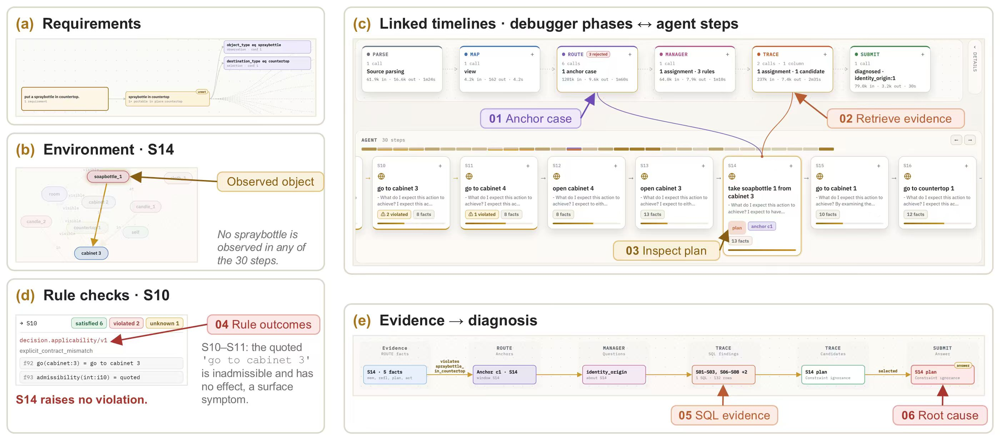
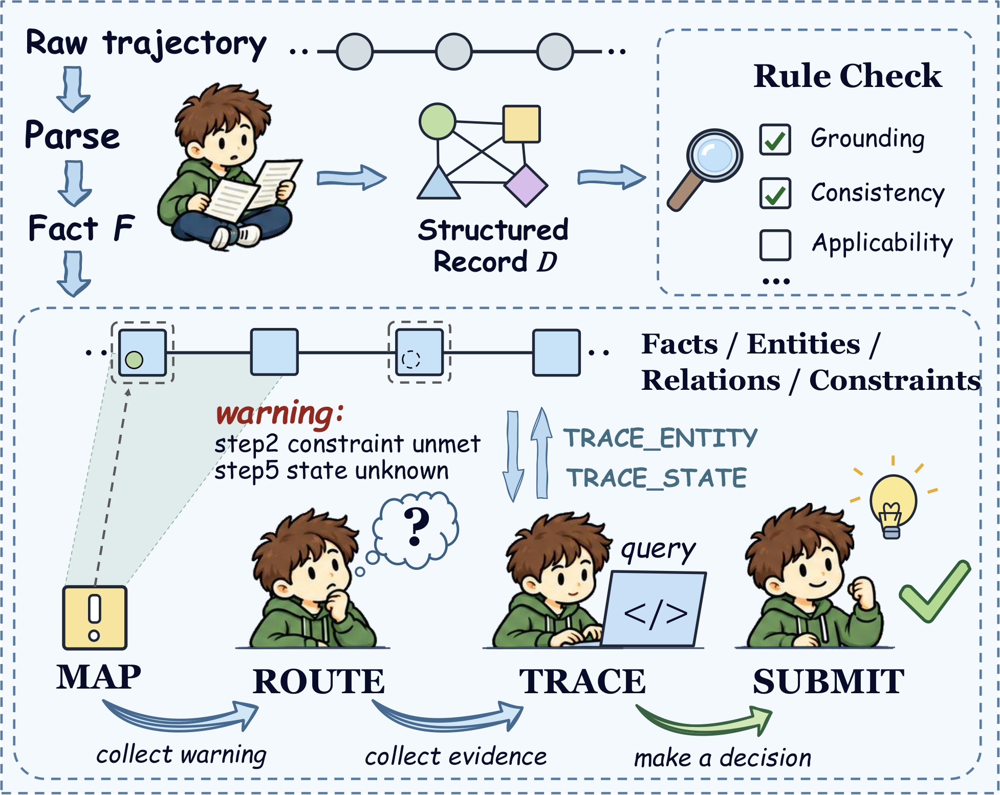

# ProDebugger

ProDebugger helps researchers inspect failures in recorded LLM-agent trajectories. It compiles a trajectory into typed, source-linked evidence, then guides an investigation through **MAP → ROUTE → TRACE → SUBMIT**. The result is an evidence-backed failure hypothesis with visible uncertainty—not proof of causation.

## At a glance

- **Input:** a recorded ALFWorld or WebShop agent trajectory.
- **Output:** a browsable investigation linking a candidate failure step to supporting trace evidence and uncertainty.
- **Use it to:** inspect agent failures, review how a diagnosis was reached, and explore the included benchmark traces.

The fastest way to see the project work is to run the offline example below. It compiles one ALFWorld and one WebShop trace, executes a read-only evidence query for each, and saves a browsable report; no model endpoint or API key is involved.



This case overview shows how requirements, environment observations, rule checks, and retrieved evidence connect to a selected diagnosis. The [workflow diagram](assets/prodebugger-workflow.png) gives a compact view of the processing stages.

<a id="setup"></a>

## Quick start

The included offline example compiles one trace from each environment and runs a read-only evidence query. It makes no model calls and needs no API key.

```bash
python3 -m venv .venv
source .venv/bin/activate
python -m pip install -r requirements.txt
python -B inspect_examples.py
```

To browse the workbench, start the local server in a second terminal:

```bash
python web/server.py
```

Open <http://127.0.0.1:8770>. The script writes its example report under `artifacts/reviewer_examples/`; a checked-in copy is available as [EXAMPLE_REPORT.json](documentation/EXAMPLE_REPORT.json). See the [step-by-step walkthrough](documentation/REVIEWER_GUIDE.md#reproduce-the-two-environment-examples) to inspect the generated records and query results.

**Expected result:** the report contains one ALFWorld and one WebShop example, each with the query, returned evidence rows, source provenance, and coverage limitations. It demonstrates that the offline compilation/query path runs; it is not an online diagnosis or an accuracy result.

Python 3.12 or later is required (tested with Python 3.13). `pyarrow` supports Parquet input, and `sqlglot` powers the read-only query interface used by the offline example. `openai` and `python-dotenv` are only needed for online model runs; offline examples do not require credentials.

## How an investigation works



The compiler audits the input and prepares typed facts, goals, entities, source provenance, and parsing gaps. Seven abstract checks can flag leads for investigation; a flag is not a confirmed failure. The diagnostic stages then:

| Stage | What it does |
| --- | --- |
| **MAP** | Identifies unmet or unresolved task goals. |
| **ROUTE** | Finds source-backed issue anchors in the recorded evidence. |
| **TRACE** | Investigates candidates with targeted, read-only evidence queries. |
| **SUBMIT** | Compares the supplied candidates and selects one when available. |

Missing evidence remains unknown. A selected hypothesis does not establish that it is the unique or actual cause. The [implementation guide](documentation/REVIEWER_GUIDE.md) explains the evidence constraints and how to interpret results.

## Benchmark traces

This branch includes **105 annotated trajectories**: 66 ALFWorld and 39 WebShop. Browse the [Parquet dataset](core/data/train.parquet?raw=true), [ALFWorld example](core/data/examples/alfworld.json), [WebShop example](core/data/examples/webshop.json), or [data schema and manifest](core/data/README.md).

The 105 rows are the ALFWorld/WebShop subset of a supplied 139-row file; 34 GAIA rows are excluded. The original values and row order are preserved. The filename `train.parquet` follows the source file and does not indicate a new train/validation/test split. Reference annotations are retained for evaluation, while the debugger reads only `trajectory_id`, `task_type`, and `full_trajectory` from Parquet input.

The offline quick start demonstrates that the two included domain examples can be compiled and queried. It is not an online diagnosis or an accuracy result. See the [implementation guide](documentation/REVIEWER_GUIDE.md#interpreting-results-and-extending-to-other-traces) for evaluation limits.

## Run an online diagnosis

Online runs require an OpenAI-compatible Chat Completions endpoint that supports tool calls and an API key. Copy `.env.example` to `.env`, set the provider key, then run:

```bash
python -B -m prodebugger.run_experiment GPT-4o_027_alfworld_task_027 \
  --model MODEL_NAME \
  --base-url ENDPOINT \
  --env-file .env
```

Replace `MODEL_NAME` and `ENDPOINT` with your provider configuration. The default key variable is `OPENAI_API_KEY`; use `--api-key-env` to select another variable. For dry runs, sample selection, replay, resume, budgets, and output files, see [Running the debugger](documentation/RUNNING.md).

## Documentation

| Guide | What it covers |
| --- | --- |
| [Implementation guide](documentation/REVIEWER_GUIDE.md) | Terminology, evidence boundaries, offline examples, workbench walkthrough, and result interpretation. |
| [Running the debugger](documentation/RUNNING.md) | Model configuration, experiment options, replay/resume, budgets, and generated files. |
| [Example report](documentation/EXAMPLE_REPORT.json) | Saved output from the credential-free ALFWorld and WebShop compilation/query examples. |
| [Query reference](prodebugger/prompts/query_dsl.md) | Supported read-only query operators, syntax, and coverage semantics. |
| [Benchmark data](core/data/README.md) | Dataset provenance, schema, files, and reading examples. |
| [Development history](documentation/README_EVOLUTION.md) | Architecture and protocol changes, experiment notes, and limitations. |
| [Contributing](CONTRIBUTING.md) | Development setup and the checks expected before proposing a change. |

## Repository layout

```text
core/          trajectory compiler, domain profiles, evidence records, and benchmark data
prodebugger/   query interface, diagnostic stages, prompts, and run entry points
web/           local read-only workbench and run launcher
checks/        regression checks
documentation/ implementation, runtime, data, and development-history guides
```

Run commands from the repository root. Generated sessions and experiment outputs are written locally and are git-ignored.

## Development checks

The GitHub Actions workflow installs the project dependencies, runs the regression checks, and executes the credential-free examples on Python 3.12. To run the same checks locally:

```bash
python -m pip install -r requirements.txt pytest
python -m pytest checks -q
python -B inspect_examples.py
```
