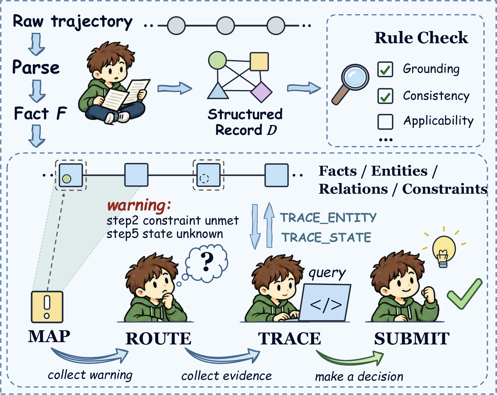

  <a href="https://galoish.github.io/ProDebugger/#/">
    <picture>
      <source media="(prefers-color-scheme: dark)" srcset="assets/prodebugger-title-dark.png">
      
    </picture>
  </a>

  <em>A Programmable Platform for Evidence-Grounded Debugging of LLM Agent Trajectories</em>

 

  <strong>Platform:</strong> <a href="https://galoish.github.io/ProDebugger/#/">https://galoish.github.io/ProDebugger/#/</a>
  &nbsp;·&nbsp; English | <a href="README.zh-CN.md">简体中文</a>

  <a href="https://galoish.github.io/ProDebugger/video/demo.mp4"><strong>▶ Watch the demo video</strong></a>

 

ProDebugger helps researchers understand why a recorded LLM-agent trajectory failed. It turns a trajectory into source-linked evidence and walks an investigation through **MAP → ROUTE → TRACE → SUBMIT**, ending with an evidence-backed failure hypothesis and its remaining uncertainty.

> [!NOTE]
> This repository is a public placeholder. The implementation is not released yet; the interface in [`prodebugger/api.py`](prodebugger/api.py) only describes the planned entry point. To see ProDebugger in action, use the [online platform](https://galoish.github.io/ProDebugger/#/), which replays recorded example diagnoses in the browser.

## How an investigation works

  

| Stage | What it does |
| --- | --- |
| **MAP** | Identifies task goals that were left unmet. |
| **ROUTE** | Narrows the trajectory down to a few suspicious steps. |
| **TRACE** | Gathers evidence about each suspect from the recorded trajectory. |
| **SUBMIT** | Compares the findings and selects a failure hypothesis. |

See [documentation/OVERVIEW.md](documentation/OVERVIEW.md) for the inputs and outputs of each stage, and [documentation/samples/sample_report.json](documentation/samples/sample_report.json) for the shape of a final report.

## Repository layout

| Path | Contents |
| --- | --- |
| `core/` | Schema of a compiled trajectory record: [`record.py`](core/record.py), [`kinds.py`](core/kinds.py), [`relations.py`](core/relations.py) |
| `prodebugger/` | Rule and evidence schema ([`dsl.py`](prodebugger/dsl.py)) and the planned entry point ([`api.py`](prodebugger/api.py)) |
| `web/` | Pointer to the online platform |
| `documentation/` | Stage overview and a sample report |
| `checks/`, `core/data/`, `core/profiles/`, `prodebugger/prompts/` | Placeholders; not yet released |

The schema files describe the data shown on the online platform. They contain no implementation.

## Status

| Item | Status |
| --- | --- |
| Online platform with recorded example diagnoses | Available |
| Source code | Not yet released |
| Benchmark traces | Not yet released |

## Contact

Questions and collaboration requests are welcome through [GitHub issues](https://github.com/GaloisH/ProDebugger/issues).

## License

Copyright © 2026 the ProDebugger authors. All rights reserved. No license is granted for the contents of this repository until the code is released.
