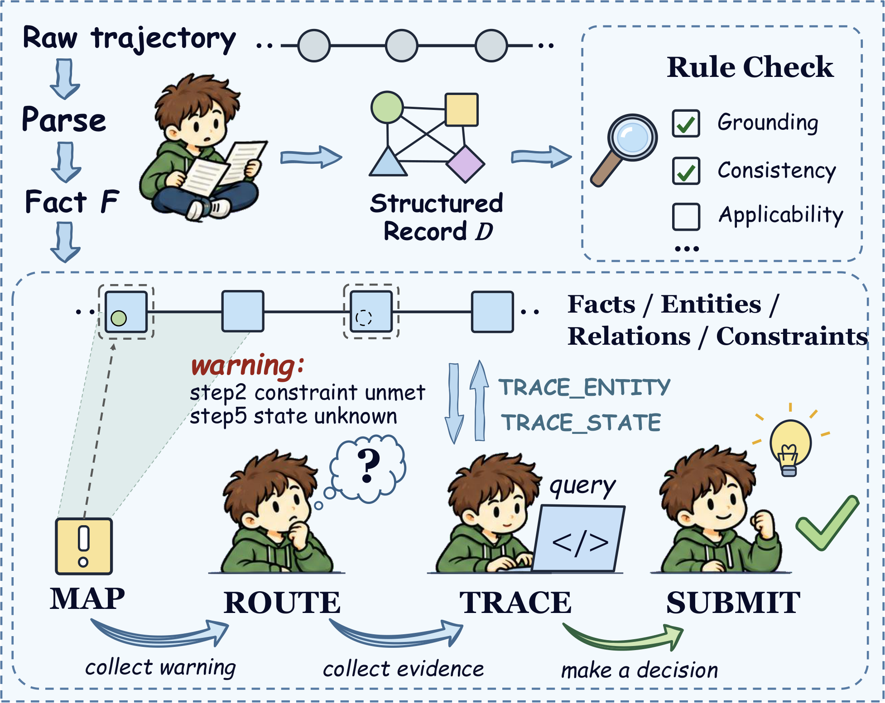

  <a href="https://galoish.github.io/ProDebugger/#/">
    <picture>
      <source media="(prefers-color-scheme: dark)" srcset="assets/prodebugger-title-dark.png">
      
    </picture>
  </a>

  <em>面向 LLM Agent 轨迹、以证据为依据的可编程调试平台</em>

 

  <strong>在线平台：</strong> <a href="https://galoish.github.io/ProDebugger/#/">https://galoish.github.io/ProDebugger/#/</a>
  &nbsp;·&nbsp; <a href="README.md">English</a> | 简体中文

  <a href="https://galoish.github.io/ProDebugger/video/demo.mp4"><strong>▶ 观看演示视频</strong></a>

 

ProDebugger 帮助研究者理解一条已记录的 LLM Agent 轨迹为什么失败。它把轨迹整理成可追溯到原文的证据，并按 **MAP → ROUTE → TRACE → SUBMIT** 四个阶段展开调查，最终给出有证据支撑的失败假设，以及仍然存在的不确定性。

> [!NOTE]
> 本仓库目前只是公开占位页，实现代码尚未发布；[`prodebugger/api.py`](prodebugger/api.py) 仅描述计划中的调用入口。想看实际效果，请访问[在线平台](https://galoish.github.io/ProDebugger/#/)，它会在浏览器中回放已记录的示例诊断。

## 调查流程

  

| 阶段 | 作用 |
| --- | --- |
| **MAP** | 找出任务中未被满足的目标。 |
| **ROUTE** | 把范围缩小到少数可疑步骤。 |
| **TRACE** | 从已记录的轨迹中为每个可疑步骤收集证据。 |
| **SUBMIT** | 比较各项发现，选出一个失败假设。 |

各阶段的输入与输出见 [documentation/OVERVIEW.md](documentation/OVERVIEW.md)，最终报告的形式见 [documentation/samples/sample_report.json](documentation/samples/sample_report.json)。

## 目录结构

| 路径 | 内容 |
| --- | --- |
| `core/` | 编译后轨迹记录的数据结构：[`record.py`](core/record.py)、[`kinds.py`](core/kinds.py)、[`relations.py`](core/relations.py) |
| `prodebugger/` | 规则与证据的数据结构（[`dsl.py`](prodebugger/dsl.py)）以及计划中的调用入口（[`api.py`](prodebugger/api.py)） |
| `web/` | 指向在线平台 |
| `documentation/` | 阶段概览与报告样例 |
| `checks/`、`core/data/`、`core/profiles/`、`prodebugger/prompts/` | 占位目录，内容尚未发布 |

这些结构文件只描述在线平台上展示的数据格式，不包含任何实现。

## 当前状态

| 项目 | 状态 |
| --- | --- |
| 在线平台（含已记录的示例诊断） | 已上线 |
| 源代码 | 尚未发布 |
| 基准轨迹数据 | 尚未发布 |

## 联系方式

欢迎通过 [GitHub Issues](https://github.com/GaloisH/ProDebugger/issues) 提问或洽谈合作。

## 许可

Copyright © 2026 the ProDebugger authors. 保留所有权利。代码正式发布前，本仓库内容不授予任何许可。
